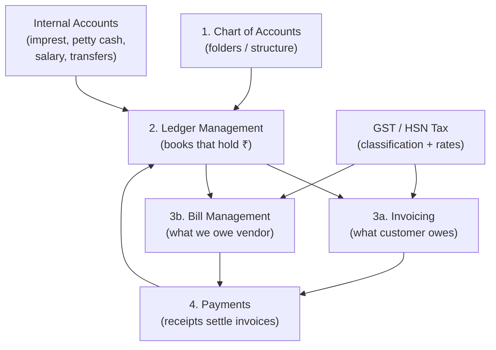

# Seravion ERP — Accounts & Finance Documentation Hub

This directory contains the **complete, in-depth documentation** for the Finance & Accounts domain of Seravion Connect. Every module document here reflects the **live codebase** as analysed from actual entity classes, service implementations, controllers, and frontend helpers.

---

## 📚 Document Index

| # | Document | What it covers |
|---|----------|----------------|
| 1 | [chart-of-accounts.md](./chart-of-accounts.md) | The five-group COA folder tree; postable heads; debit/credit rules; RBAC |
| 2 | [ledger-management.md](./ledger-management.md) | Named books (customer, vendor, cash, bank, tax); auto vs manual creation; statements; opening balances |
| 3 | [invoicing.md](./invoicing.md) | Sales invoicing — Direct, From SO, Auto-draft; Tax Invoice, Proforma, Bill of Supply; approve & post |
| 3b | [gst-invoice-testing.md](./gst-invoice-testing.md) | One GST invoice test: document choice, place of supply, and the ledger each document posts |
| 4 | [bill-management.md](./bill-management.md) | Purchase bills — PO-linked, URD rules, confirm & post; debit notes; status lifecycle |
| 5 | [gst-hsn-tax-workflow.md](./gst-hsn-tax-workflow.md) | GST in India; CGST/SGST/IGST rules; HSN/SAC; place of supply; URD procurement |
| 6 | [payments.md](./payments.md) | Receipt, Payment, Contra, Journal vouchers; allocation; settle & close; TDS |
| 7 | [internal-accounts.md](./internal-accounts.md) | Internal GL module — imprest, petty cash, salary, fund transfers; opening balance sync |
| 8 | [testing-scenarios.md](./testing-scenarios.md) | Dedicated end-to-end testing guide for all modules with positive and negative cases |
| 9 | [proper-books-research.md](./proper-books-research.md) | Accountant research: depreciation, year-end close, next-year opening transfer, and live loopholes |
| 10 | [live-flow-loopholes-and-plan.md](./live-flow-loopholes-and-plan.md) | Loopholes in live invoices, bills, payments, openings, and closings, with the fix plan |

---

## 🗺️ System Flow (Big Picture)



---

## 📋 Key Design Principles

1. **Draft never hits ledgers.** Only Approve (invoice) or Confirm (bill) posts books.
2. **Every posting is balanced.** `Total Debit = Total Credit` on every voucher.
3. **Unregistered vendors (URD) cannot have GST.** The frontend strips tax; the backend enforces it at create and confirm.
4. **Only a regular GST branch can issue a Tax Invoice.** No GSTIN, or a composition scheme, must use Bill of Supply. Proforma is a quote and never posts the ledger.
5. **B2C Place of Supply = Billing/Delivery Site State,** not the branch state. GST is still charged. A GST card is copied only when its state matches that site.
6. **One active bill per PO.** A second bill can only be created after the first is cancelled.
7. **Opening balances sync automatically.** Updating a ledger's opening balance creates a matching `LedgerEntry` to keep books balanced.

---

## 🧾 GST State Decision Matrix

| Branch State | Customer/Vendor State | Tax Split |
|---|---|---|
| Same state | Same state | **CGST + SGST** (each = half) |
| Different states | Different states | **IGST** (full rate) |
| Vendor = Unregistered | Any | **No GST** (zero input tax) |
| Branch = Unregistered, or scheme = Composition | Any | **Bill of Supply** — no GST. Cannot save a Tax Invoice |
| Branch = Regular GSTIN, every line tax 0 | Any | **Bill of Supply** — no GST |
| Branch = Regular GSTIN, any line taxable | Any | **Tax Invoice** — GST charged, including B2C |
| User only wants a price | Any | **Proforma** — zero GST, status **Issued**, no ledger |
| Customer = Unregistered (B2C) | Billing/Delivery site state used for POS | CGST+SGST or IGST based on site vs branch |

---

## 📊 Bill Status Lifecycle

```
DRAFT → PENDING → PARTIAL → PAID
              ↓
           OVERDUE → PARTIAL → PAID
              ↓
          CANCELLED (from DRAFT only)
```

## 📊 Invoice Status Lifecycle

```
DRAFT → SENT → PARTIAL → PAID (cash receipt)     Tax Invoice and Bill of Supply
           ↓                ↓
        OVERDUE → PARTIAL → ADJUSTED (credit note)
           ↓
       CANCELLED (from DRAFT only)

DRAFT → ISSUED                                        Proforma only (no ledger, no receipt, no credit note)
```

---

*All documentation in this directory is generated from live code analysis of the Seravion Connect backend (`BillsServiceImpl.java`, `InvoicingServiceImpl.java`, `LedgerService`, etc.) and the React frontend (`AddBills.jsx`, `EditBills.jsx`, `billTaxHelpers.js`, etc.).*
