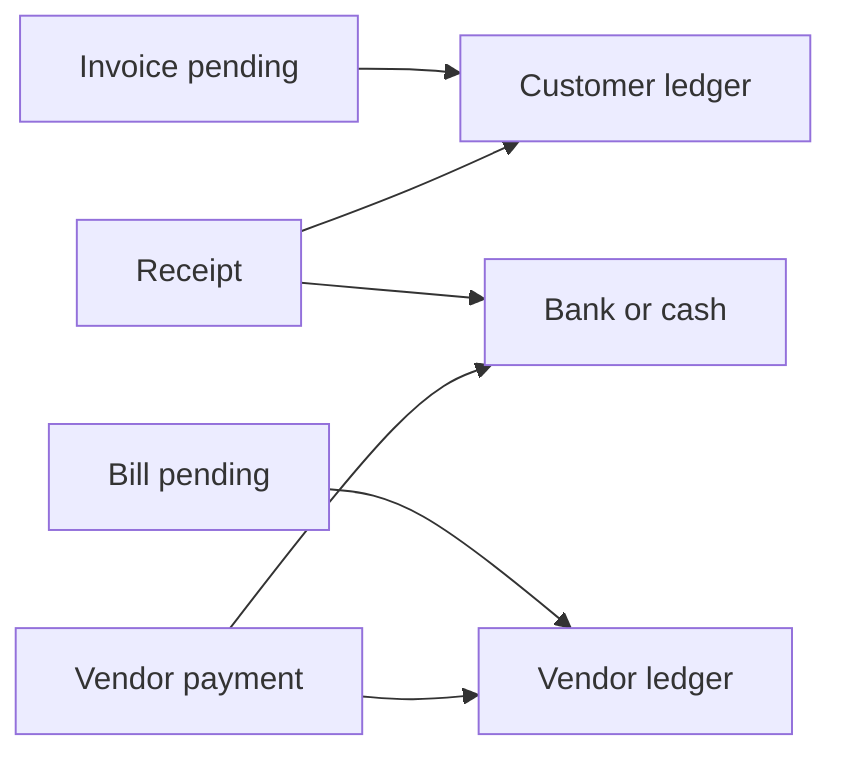

# Live accounts flows — loopholes and implementation plan

This document is for a company that is already using invoices, bills, receipts, payments, opening balances, and year close. It does **not** list missing modules such as an asset register. Those sit in [proper-books-research.md](./proper-books-research.md).

This note lists **holes in flows that already post**, where the invoice, the bill, the bank, and the ledger stop agreeing. Each hole has the office situation, what the code does today, and the build that makes the books usable.

Checked against `InvoicingServiceImpl`, `BillsServiceImpl`, `PaymentsServiceImpl`, `FinanceBooksServiceImpl`, `FinancialReportsServiceImpl`, `YearEndCloseServiceImpl`, and `FinancePostingHelper`.

---

## 1. How a working company books a rupee

Four numbers must match at the end of every day. If any one drifts, the accountant cannot file GST, chase customers, or pay vendors.

| Check | Must equal |
|-------|------------|
| Open sales invoices (pending only, not drafts, not written off) | Customer ledger balances (debit), after removing true advances |
| Open purchase bills (pending only) | Vendor ledger balances (credit), after removing true advances |
| Bank and cash statement | Bank book and cash book |
| Trial balance | Total debit = total credit, with each opening counted **once** |



**For the office user:** if the customer screen says ₹10,000 due and the customer ledger says ₹7,000, the software is not ready for a live company. The sections below are the places that break this today.

---

## 2. What already works — do not rebuild

| Flow | What posts today |
|------|------------------|
| Approve a draft tax invoice | Dr Customer (grand) · Cr Sales (grand − GST) · Cr GST output |
| Confirm a draft bill | Dr Purchase expense (taxable) · Dr GST input · Cr Vendor (net payable) · Cr TDS payable if the bill withheld TDS |
| Receipt allocated to an invoice, no TDS, no advance | Dr Bank · Cr Customer, and the invoice pending falls by the allocated amount |
| Vendor payment with no TDS | Dr Vendor · Cr Bank, and the bill pending falls by the allocated amount |
| Credit note while something is still pending | Dr Sales adjustment + Dr GST output · Cr Customer, pending falls |
| Debit note while something is still pending | Dr Vendor · Cr Purchase adjustment + Cr GST input, and TDS payable is reduced in proportion |
| Contra between two bank or cash books | Dr destination · Cr source |
| Manual journal | Balanced lines, posted immediately |
| Go-live opening | Rejected unless debit openings equal credit openings (within ₹0.02) |
| Year close button | Posts a P&L rollover to Retained Earnings and marks that year closed |

The holes are not “nothing is built.” The holes are that **void, advance, write-off, a second bill, a return after full payment, openings, and the next year** do not keep the four checks true.

---

## 3. Loopholes that stop a company operating

Severity: **P0** = books or documents lie, do not go live. **P1** = a normal month cannot be finished. **P2** = control or report is wrong, month can still be posted with care.

### 3.1 P0 — Voiding a voucher does not undo the money

**Office:** A receipt was entered as ₹50,000 instead of ₹5,000. The cashier clicks Void.

**Today:** `PaymentsServiceImpl.voidVoucher` sets `vouchers.status` to `VOID`. It does not write a reverse journal. Invoice pending, bill pending, allocations, and auto credit/debit notes stay as they were. The bank ledger still shows the ₹50,000. The customer still looks paid. A second receipt for the real ₹5,000 then credits the customer again.

**Also:** There is no edit. The only “undo” is this stamp.

**Implementation**

1. Stop treating Void as a status flag. Replace it with **Reverse**.
2. Reverse is allowed only while the voucher’s date sits in an **open** period (see §3.12).
3. Post a new voucher `REV-{original number}` dated today (or the original date if that period is still open), with every ledger line flipped.
4. For a receipt: add the allocated amounts back to each invoice’s pending, reduce `receivedAmount`, and set status back to Sent, Partial, or Overdue from the due date. Do not resurrect a draft.
5. For a payment: add the allocated amounts back to each bill’s pending and reduce `paidAmount`.
6. If the voucher created an automatic credit note or debit note (Settle & Close), reverse that note in the same transaction. Do not leave the write-off in the books after the receipt is reversed.
7. If any of those invoices or bills has a **later** allocation, refuse the reverse and tell the user which later voucher must be reversed first.
8. Mark the original `REVERSED` and store `reversalVoucherId`. A reversed voucher cannot be reversed again.
9. Receipt and payment screens get **Reverse** instead of Void. The button needs the same permission as today (Edit), plus a mandatory reason stored on the reversal.

**Done when:** reverse a ₹50,000 receipt and the bank, the customer ledger, and the invoice pending all return to the pre-receipt figures. A new ₹5,000 receipt then matches.

---

### 3.2 P0 — Customer advance is not a real ledger movement

**Office:** The customer pays ₹20,000 in April before the April invoice exists. In May, finance applies that ₹20,000 to the new invoice.

**Today:**

- An unallocated receipt credits the **customer ledger**, not Customer Advance. The extra money sits as a credit on Sundry Debtors. `unallocatedAmount` is only a column on the voucher.
- The receipt screen’s advance balance stays ₹0, so “Adjust Advance?” does not appear (`payments.md` loophole 4). “Carry to Advance?” does not change the save.
- If a later receipt does send `advanceApplied`, the posting **debits** `CUSTOMER_ADVANCE`. That ledger was never credited, so the advance account goes the wrong way, and the customer is credited a second time.

**Journals that must be posted**

```text
Money received, not yet billed:
  Dr  Bank                         20,000
      Cr  Customer Advance                 20,000

Later, apply to an invoice that was already Dr Customer / Cr Sales:
  Dr  Customer Advance             20,000
      Cr  Customer                         20,000
```

The customer ledger is touched only when an invoice exists. Until then the liability is Customer Advance.

**Implementation**

1. On receipt save, split the cash:
   - Amount allocated to invoices → Cr Customer (as today).
   - Amount not allocated → Cr Customer Advance. Do not credit the customer for this part.
2. `advanceApplied` on a later receipt debits Customer Advance and credits Customer, and cannot exceed that customer’s **credit balance on the advance ledger**, not a sum of voucher columns that can drift.
3. Load that advance balance on the receipt screen. Enable Adjust Advance only when it is above zero. Remove the toggle that does nothing, or make Carry to Advance the unallocated split above (it should be the default, not a dead control).
4. One-time data repair for companies already live: for each customer, if unallocated posted receipts were credited to the customer, journal Dr Customer · Cr Customer Advance for the still-unapplied amount. Do this before the new rule starts, or those customers stay wrong forever.

**Done when:** April advance does not reduce debtors. May application clears the advance and the invoice together. The advance ledger never has a debit balance unless a reversal is in progress.

---

### 3.3 P0 — A vendor payment can close bills for more than the bank paid

**Office:** Amount paid is ₹10,000. The user allocates ₹10,000 and ₹4,000 on two bills (screen cap can be bypassed by the API).

**Today:** Receipt save rejects `allocated > settlement`. Payment save does **not**. `createPayment` reduces each bill by the allocated figure, then debits the vendor only for `amountPaid`. `unallocatedAmount` becomes negative. Two bills can show Paid while the vendor ledger still owes the ₹4,000. The next payment chase is wrong, and the creditor balance does not match open bills.

**Implementation**

1. Same guard as receipts, before any bill is updated: sum of allocations must be **less than or equal to** the amount that actually settles bills.
2. If TDS is deducted on payment, the amount that settles bills is the **gross** (bank + TDS), not the bank figure alone. Bank credit = gross − TDS. Vendor debit = gross. Allocations cannot exceed gross.
3. Reject a negative unallocated amount.
4. Do not update bill rows until this check passes. Today bill rows are saved before the ledger post, so a later posting error can leave bills paid and the bank untouched if the transaction boundary is ever split. Keep bill updates, allocations, and ledger lines in **one** transaction (already the intent; add a test that a thrown posting error rolls the bill pending back).

**Done when:** allocations of ₹14,000 against a ₹10,000 payment return 400 and both bills stay pending.

---

### 3.4 P0 — A full payment blocks a later sales return or purchase return

**Office:** The customer paid the invoice in full. Next week the job is redone and finance must credit the whole invoice. Or the vendor was paid and then the chemical drums are returned.

**Today:** A credit note cannot exceed `pendingAmount`. After a full receipt, pending is zero, so the credit note is rejected. A debit note has the same rule on the bill. There is no “refund” voucher that debits the bank and credits the customer, or the reverse for a vendor.

The company must type a manual journal. That journal does not change the invoice or the bill, so the document and the ledger diverge (the same class of hole as §3.1).

**Implementation**

1. Allow a credit note up to the **original grand total minus credit notes already issued**, not merely the pending balance.
2. Split the credit note’s effect on the document:
   - Reduce pending first.
   - Any remainder is a **refundable credit** on the customer (customer ledger goes credit).
3. Add **Refund** on the receipt screen, linked to that credit:
   - Dr Customer · Cr Bank, for not more than the customer’s credit balance.
   - Store the link on the credit note so it cannot be refunded twice.
4. Mirror this for bills: debit note up to the original net payable minus debit notes already issued. Excess becomes a vendor debit (advance / receivable from vendor). **Vendor refund** is Dr Bank · Cr Vendor.
5. GST reversal stays as it is now (prorate CGST/SGST/IGST back off the output or input ledgers). Do not dump the tax into sales or purchase.

**Done when:** a paid ₹11,800 invoice (₹10,000 + ₹1,800 GST) can be fully credited. Customer ledger is credit ₹11,800. A refund of ₹11,800 brings the customer ledger back to zero and reduces the bank. GST output falls by ₹1,800.

---

### 3.5 P0 — Confirmed bills and sent invoices cannot be cancelled

**Office:** A bill was confirmed on the wrong vendor, or a tax invoice was approved with the wrong GSTIN. The document is no longer a draft.

**Today:** Draft invoices can be cancelled with no ledger impact. Sent invoices have no cancel; the list “Cancel” opens a credit note. Confirmed bills have no cancel at all (`bill-management.md` gap 1 and 6). A credit note or debit note is the right tool for a **commercial** return. It is the wrong tool for “this document should never have existed,” because the note needs a pending balance (§3.4) and it leaves the original document looking like a real sale or purchase.

**Implementation**

1. **Cancel posted invoice** (finance permission, reason required), only when:
   - no receipt allocation exists, and
   - no credit note exists, and
   - the invoice date is in an open period.
2. Post the exact reverse of approve: Dr Sales · Dr GST output · Cr Customer, for the same amounts. Status becomes `CANCELLED`. Pending becomes zero. The sales order may be invoiced again.
3. **Cancel posted bill** with the same rules (no payment, no debit note, open period). Reverse: Dr Vendor · Dr TDS payable (if any) · Cr Purchase expense · Cr GST input. Status `CANCELLED`. The purchase order can be billed again (§3.6).
4. If money has already moved, cancel is refused. The user must reverse the receipt or payment first (§3.1), then cancel, or use a credit/debit note (§3.4) if the sale or purchase was real.

**Done when:** a sent invoice with no receipt can be cancelled and the customer ledger, sales, and GST output return to the pre-approve balances. The same sales order can be invoiced again.

---

### 3.6 P1 — Only one live bill per purchase order

**Office:** A chemical purchase order is received in two lots. Each lot has its own vendor invoice. Finance must book both, and pay both.

**Today:** `validatePurchaseOrderLink` rejects a second bill while any non-cancelled bill exists for that PO. Confirmed bills cannot be cancelled (§3.5), so the second vendor invoice cannot be entered at all. The first bill also cannot be a partial bill against the PO quantity.

**Implementation**

1. Allow many bills per PO while the sum of **billed quantity per PO line** does not exceed the received quantity (GRN), and does not exceed the ordered quantity.
2. Each bill still confirms its own ledger posting. Do not post the whole PO on the first bill.
3. The PO picker shows remaining qty, not a hard hide as soon as one bill exists.
4. A cancelled bill (§3.5) releases its quantity.
5. Keep the old rule only for a bill that has no lines tied to PO lines (free-text expense). Expense bills do not use the PO lock.

**Done when:** two vendor invoices against one PO both confirm, creditor equals the sum of both net payables, and a third bill for a quantity already billed is rejected.

---

### 3.7 P1 — Every bill hits one purchase account, including rent and furniture

**Office:** The profit and loss should show chemical purchase, rent, fuel, and repairs on different lines. A vehicle should not be “purchase.”

**Today:** `BillsServiceImpl.confirm` always debits `BILL_CONFIRM_EXPENSE` (the purchase-expense binding) for `taxableAmount`. The expense category on an expense bill (`RENT`, `EQUIPMENT`, `CHEMICAL`, …) is stored and never used in the journal. Gross profit treats rent as trading purchase. A fixed asset bought on a bill never becomes an asset (the asset design itself is in [proper-books-research.md](./proper-books-research.md) §5).

**Implementation**

1. Add a posting map: expense category → ledger. Seed at least Chemical / materials → purchase expense, Rent, Utilities, Repairs, Professional fees, Insurance, and Other. Finance can change the map.
2. On confirm, debit **that** ledger, not always purchase. GST input and vendor credit stay as they are.
3. Add a line flag **Capitalise**. Those lines debit the chosen asset ledger (Vehicles, Plant, Furniture) instead of an expense. They do not affect gross profit.
4. A bill may mix lines only if every line resolves to a ledger. If the category has no map, confirm is rejected with the category name. Do not silently fall back to purchase.
5. Debit notes reverse the **same** ledgers the bill used, in proportion. Store the ledger id on the bill line at confirm time so a later map change does not reverse into a different account.

**Done when:** a rent bill debits Rent, a chemical bill debits Purchase, and the profit and loss no longer shows rent inside gross profit.

---

### 3.8 P0 — Opening balances are counted twice, and can be rewritten after work has started

**Office:** On 1 April the bank opening is ₹5,00,000. The accountant prints a trial balance the same day, then later “corrects” openings in December.

**Today:**

- Go-live writes `ledgers.opening_balance` **and** posts an `OPENING` ledger entry for the same figure (`FinanceBooksServiceImpl.postOpenings`).
- The trial balance adds the master opening **and** every ledger entry up to the date, including that opening entry (`FinancialReportsServiceImpl.getTrialBalance`). The bank can print as ₹10,00,000.
- After go-live, `updateOpenings` is still allowed. It resets every ledger’s opening, **deletes** the `OPEN-1` entries, and posts them again. Receipts and invoices already in the year stay. The statement and the opening no longer describe one set of books.

**Implementation**

1. Trial balance opening column = master opening only. Period movement = ledger entries **except** `ref_type = OPENING`. Closing = opening + movement. Add a test with a ₹5,00,000 opening and zero other entries: closing debit is ₹5,00,000, and total debit equals total credit.
2. Freeze openings once any voucher, invoice, or bill has been posted on or after the books-from date. The update API returns 400: “Openings are frozen. Pass a journal in the open period.”
3. A correction after that date is a normal journal (Dr / Cr the ledger, and the other side Opening balance equity or the ledger that was wrong). It does not delete `OPEN-1`.
4. Before the first real voucher, the current replace-openings behaviour may stay, so the wizard can still be fixed on day one.

**Done when:** the day-one trial balance matches the opening sheet the accountant typed, and a December “update openings” call does not delete April’s opening voucher.

---

### 3.9 P0 — Collections and payables aging chases the wrong amount

**Office:** A ₹10,000 invoice was partly received for ₹6,000. The collector should chase ₹4,000. A draft that was never approved is not money owed. A written-off invoice is not money owed.

**Today:** `getAgingReport` sums `grand_total` (sales) or `net_payable` (bills) for every row whose status is not `CANCELLED` or `PAID`. That includes:

- **Draft** invoices and bills (not yet in the ledger)
- **Partial** documents at the **full** original value, not the pending value
- **Adjusted** invoices (credit note already cleared them) because Adjusted is not Paid
- Debit-note write-offs that set the bill to **Paid**, so those drop off aging, while the matching sales write-off stays on aging

The report also ages from the document date, not the due date, so a 45-day credit invoice looks overdue on day one.

**Implementation**

1. Age `pending_amount` only.
2. Include only Sent, Partial, Overdue for invoices, and Pending, Partial, Overdue for bills.
3. Exclude Draft, Cancelled, Paid, and Adjusted.
4. Bucket by **due date**, not document date. Current = not yet due. Then 1–30, 31–60, 61–90, 90+ past due.
5. The report total must equal the sum of those pending amounts, and that sum must equal the customer (or vendor) ledger total after advances are removed (§3.2). Show a warning line when they differ, with the difference. Do not hide the difference.
6. Use the same status for a write-off on both sides: invoice **Adjusted**, bill **Adjusted** (today a bill write-off becomes Paid, which looks like the vendor was paid in cash).

**Done when:** the ₹4,000 example ages as ₹4,000. Drafts and adjusted invoices do not appear. The aging total matches open debtors.

---

### 3.10 P1 — Settle & Close writes off through the trading accounts and can disagree with the cash

**Office:** The customer pays ₹9,500 against a ₹10,000 invoice and finance ticks Settle & Close for the ₹500. That ₹500 is a small balance written off, not a purchase return and not extra sales.

**Today:** Settle & Close calls `issueCreditNote` / `issueDebitNote`. The ₹500 debits **Sales adjustment** (or purchase adjustment) and GST in proportion. Those heads are marked “affects gross profit,” so a discount looks like a sales return inside gross profit. The bill then becomes **Paid** (as if cash arrived). The invoice becomes **Adjusted**.

Payment Settle & Close used to send the reason label (“Purchase Return”) into a field that expected a code. The server now maps several labels. Anything it does not recognise is stored as `OTHER`. The write-off still hits the adjustment account, not a discount or bad-debt account.

**Implementation**

1. Settle & Close posts a **write-off**, not a tax credit note, unless the user explicitly chooses “sales return / purchase return.”
2. Write-off journal (sales), no GST reversal (the supply happened; the balance is waived):

```text
Dr  Discount allowed / bad debts     500
    Cr  Customer                             500
```

3. Purchase short-close:

```text
Dr  Vendor                           500
    Cr  Discount received                    500
```

4. A real return stays on the credit-note and debit-note screens, with GST reversal, and is not the default of Settle & Close.
5. Both documents end as **Adjusted**, with a reason code `WRITE_OFF` or `RETURN`. Paid is only for money received.
6. The write-off amount is the shortfall on that allocation. It cannot exceed pending. It is reversed if the parent receipt or payment is reversed (§3.1).

**Done when:** a ₹500 settle reduces the customer or vendor and hits discount, not gross-profit sales or purchase. The document is Adjusted, not Paid.

---

### 3.11 P1 — TDS can be booked twice or in the wrong month, and only in one bucket

**Office:** The vendor bill says TDS is deducted. The company pays the vendor the net and later deposits TDS. The return needs section 194C separate from 194J.

**Today:**

- If the bill has `tdsAmount`, confirm already credits `TDS_PAYABLE` and the vendor is credited only the net.
- Payment then skips TDS for bills that already withheld (`TdsCalculator` skips `billWithheldTds`). That part is correct.
- If the bill did **not** withhold, payment computes TDS from a rate and credits the **same** single `TDS_PAYABLE` ledger, and reduces the bank. The vendor is debited the gross. That is a valid “TDS at payment” pattern, but the bill’s pending is reduced only by the allocated amount. If the user allocates the net and the server also withholds TDS, the vendor ledger and the bill pending do not describe the same settlement.
- Vendor master TDS section is not used. All sections share one liability. The company cannot file 26Q from this ledger.
- Customer TDS on a receipt debits one `TDS_RECEIVABLE`. There is no link to the invoice line or the customer’s PAN for the 26AS match.

**Implementation**

1. One policy, chosen on the bill, not both: **TDS on bill** or **TDS on payment**. If the bill already has TDS, payment must not compute more TDS for that bill (already true; add a test). If the user allocates only the net, pending falls by the net, and the TDS portion is not allocated again.
2. Store `tds_section` (194C, 194J, 194I, 194Q, …) on the bill from the vendor master, overridable on the bill. Credit a ledger per section, not one TDS payable.
3. The challan payment (statutory screen or a vendor-style payment) debits that section ledger and credits the bank. Open TDS aging is the section balance, by month of deduction.
4. Customer receipt TDS stores the invoice id, section, and rate on the voucher line so the receivable can be matched when the customer’s TDS shows in 26AS.

**Done when:** a 194J bill and a 194C bill increase two different liabilities, payment does not add a third credit, and the vendor pending equals the vendor ledger.

---

### 3.12 P0 — Closing the year does not close the books, and April has no new book

**Office:** On 1 April the company starts a new year. March invoices must be impossible. April opening must equal 31 March cash, debtors, creditors, and capital. April sales must start at zero.

**Today:**

- Year close posts the P&L rollover and sets periods to `LOCKED` (`YearEndCloseServiceImpl`).
- `FinancePostingHelper` does not read that lock. It only blocks dates before books-from. A March invoice can still be approved in April. The closed profit is then wrong, and nothing updates Retained Earnings.
- No next financial year is created. There is no opening voucher on 1 April. The balance sheet still adds profit from **1 January**, not from 1 April, and can add profit again on top of Retained Earnings.
- The year-end screen’s checklist (depreciation, bank, statutory) is painted as done. It does not read any balance.
- Income or expense ledgers with a balance on the “wrong” side (credit notes larger than sales) are skipped, so they do not actually reach zero.

The full close design (depreciation, next-year opening journal, signed P&L nets) is in [proper-books-research.md](./proper-books-research.md) §4 and §6. This plan is the part that protects **invoices, bills, and payments**.

**Implementation**

1. In `FinancePostingHelper`, before any post: if `entryDate` falls in a period with status `LOCKED`, reject. Invoice approve, bill confirm, receipt, payment, contra, journal, credit note, and debit note all use this helper (receipts and payments that call `ledgerService.postEntry` directly must use the same check — today the simple receipt and payment paths **bypass** the helper).
2. Put the date check on `ledgerService.postEntry` itself so no caller can skip it.
3. After a successful close, create the next year and twelve open periods, and post one opening voucher on day one with balance-sheet balances only. Do not copy sales, purchase, rent, or salary into the new year.
4. Refuse close when the trial balance (after the §3.8 fix) does not balance, or when any invoice or bill is Draft dated inside the year (approve, delete, or cancel them first).
5. Reopen of a month is CEO plus a reason, and is refused if a later year opening has already been posted and that new year has vouchers.

**Done when:** approve of an invoice dated 31 March fails after close. A receipt dated 1 April posts in the new year. April’s sales ledger opening is zero. April’s bank opening equals March’s bank closing.

---

### 3.13 P1 — Contra can empty a book that has no money, and journals have no second person

**Office:** Cash in hand is zero. Someone transfers ₹1,00,000 from cash to bank. Or a junior posts Dr Bank · Cr Expense to “correct” a personal payment.

**Today:** Contra checks the source balance only when that balance is **already greater than zero**. A zero or credit balance skips the check, so the transfer is posted and cash goes negative. Journal posts immediately, any ledger, no approval. That includes the bank.

**Implementation**

1. Contra: source signed balance must be **at least** the transfer amount. Zero is not enough. Show the balance on the screen before save.
2. Journal: lines that touch a bank or cash ledger, or a customer or vendor ledger, stay in `PENDING` until a second user (not the maker) approves. Approval posts the ledger entries. Reject does not post.
3. System journals (opening, year close, depreciation, receipt, payment) are not in this queue. They are already posted by their own flow and must store the source document id.
4. A journal that only moves two expense or income ledgers may post immediately if the company turns that option on. Default is approval for every manual journal.

**Done when:** a contra larger than the cash balance is rejected. A bank journal does not change the bank until a second person approves.

---

### 3.14 P1 — The customer ledger and the invoice list are not tied together

**Office:** Someone passes a journal against the customer, or a receipt is void-stamped (§3.1). The invoice still shows an old pending. The statement shows another figure. The collector does not know which to trust.

**Today:** Invoice pending is updated only inside receipt allocation and credit notes. The ledger is updated by those and also by any journal. Nothing recomputes one from the other. Aging (§3.9) uses a third figure (the original grand total).

**Implementation**

1. Do not allow a manual journal to post directly to a customer or vendor ledger. Those movements must be a receipt, payment, credit note, debit note, or refund, so the document pending changes in the same transaction.
2. Add a daily (and on-demand) **control check** per party:

```text
customer ledger net debit
  − customer advance credit balance
  = sum of that customer’s invoice pending
```

The same for vendors and bill pending. The books setup and the finance home show the difference. A non-zero difference blocks year close (§3.12).

3. Direct (non-SO) invoices remain valid. They still update the same customer ledger. The hole is the side door, not the invoice itself.

**Done when:** the control check is zero after a normal invoice and receipt, and a journal screen cannot pick a customer ledger.

---

### 3.15 P2 — Round-off, proforma, and a second invoice on the same job

These do not always unbalance the trial balance. They do make a company’s sales figure and job margin wrong.

| Hole | Today | Plan |
|------|--------|------|
| Round-off sits inside sales | Approve sets income = grand − GST. The `ROUNDING_OFF` ledger is never used. A ₹0.40 round-off becomes sales. | If `roundOffAmount` is not zero, credit or debit `ROUNDING_OFF` and keep sales equal to taxable value. |
| Proforma approve posts sales | A proforma is not a tax invoice, but approve still debits the customer and credits sales for the full grand (`BUG-0124` only strips GST). A later tax invoice for the same job posts sales again. | Proforma must not post the ledger. Status stays “issued, not in books.” Only the tax invoice posts. If a proforma was already posted, cancel it with the §3.5 reverse before the tax invoice is approved. |
| Second manual invoice on a sales order is blocked | `BUG-0125` hard-blocks another invoice when one is already Sent. Extra work on the same job cannot be billed. Auto drafts for contracts are exempt, so behaviour depends on the path. | Block only when the new invoice would bill **the same SO line quantity** again. An additional line (extra visit, extra chemical) is allowed. Show the already billed qty on the create screen. |
| Copy-from-SO on a Direct invoice does not link the order | The job report never sees that invoice. | If lines carry a source sales order id, save the link the same way From SO does. |

---

### 3.16 P2 — Desk bugs that hide money the books already have

These are already listed in [payments.md](./payments.md) §13. They are included here because a company will think the advance or the receipt does not exist.

| What the user sees | Cause | Fix |
|--------------------|--------|-----|
| Unallocated advance card ₹0 | Summary field name does not match the card | Bind the card to `unallocatedAdvance` |
| Payment mode filter returns nothing | Screen sends “Bank Transfer”, database stores `BANK` | Send the stored code |
| Date filter misses rows | Filter runs on the current page only | Send from/to dates to the list API |
| Register shows every branch | List is not scoped | Scope to the user’s branches, same as bills |
| Save & Print does nothing | Button has no handler | Download the voucher PDF that already exists, then return to the register |
| Cheque date is not stored | Validated on the receipt screen only | Store `instrumentDate` on the voucher. Bounce is a later receipt reversal (§3.1) plus bank charges |

---

## 4. Target journals after the fixes (one page)

| Event | Debit | Credit |
|-------|--------|--------|
| Tax invoice approved | Customer | Sales, GST output, Rounding if any |
| Proforma issued | No ledger | No ledger |
| Invoice cancelled (no receipt) | Sales, GST output | Customer |
| Credit note (return) | Sales adjustment, GST output | Customer |
| Write-off of short balance | Discount / bad debts | Customer |
| Receipt allocated | Bank | Customer |
| Receipt unallocated | Bank | Customer advance |
| Apply advance | Customer advance | Customer |
| Refund to customer | Customer | Bank |
| Bill confirmed (expense) | Mapped expense, GST input | Vendor, TDS section if withheld on bill |
| Bill confirmed (asset line) | Asset ledger, GST input | Vendor |
| Bill cancelled (no payment) | Vendor, TDS | Expense or asset, GST input |
| Debit note (return) | Vendor, TDS portion | Purchase adjustment, GST input |
| Short-close a bill | Vendor | Discount received |
| Vendor payment | Vendor | Bank, TDS section if withheld on payment |
| Vendor refund received | Bank | Vendor |
| Contra | Destination bank or cash | Source bank or cash, only up to source balance |
| Opening, day one and each new year | Balance-sheet debits | Balance-sheet credits |
| Year close | Income ledgers (credit balances) | Expense ledgers (debit balances), Retained earnings |

Every row is rejected when the date is in a locked period.

---

## 5. Build order

Do not start with year close. A close copies today’s errors into next year.

| Wave | Loopholes | Why this order |
|------|-----------|----------------|
| **1. Stop the bleed** | §3.1 Reverse, §3.3 Payment allocation cap, §3.8 Trial balance opening once, freeze openings, §3.12 Period lock inside `postEntry` | Wrong vouchers can be undone, and a closed month stays closed |
| **2. Documents match ledgers** | §3.2 Advance, §3.4 Return after payment, §3.5 Cancel posted doc, §3.9 Aging, §3.10 Write-off vs return, §3.14 Control check | Collectors and the bank book use one figure |
| **3. A real month** | §3.6 Many bills per PO, §3.7 Expense and asset ledgers, §3.11 TDS by section, §3.13 Contra limit and journal approval | Purchase, rent, and TDS look like the company’s chart |
| **4. New year** | §3.12 next-year opening, plus depreciation from [proper-books-research.md](./proper-books-research.md) | April opens from a balance sheet that already ties |
| **5. Desk** | §3.15 Round-off, proforma, second invoice, §3.16 Filters and print | Sales reports and the cashier’s screen match the ledger |

---

## 6. Acceptance a company accountant will run

Run these on a copy of a live tenant before calling accounts fit for use.

| # | Steps | Pass |
|---|--------|------|
| 1 | Opening bank ₹5,00,000 only. Print trial balance. | Bank ₹5,00,000. Debit total = credit total. |
| 2 | Approve invoice ₹11,800 (₹10,000 + 18% GST). Receipt ₹11,800. | Invoice Paid. Customer ledger 0. Bank up ₹11,800. GST output ₹1,800. |
| 3 | Reverse that receipt. | Invoice pending ₹11,800 again. Bank and customer back to step 2 before the receipt. |
| 4 | Receipt ₹20,000 with no invoice. | Customer Advance credit ₹20,000. Debtors unchanged. |
| 5 | New invoice ₹11,800. Apply ₹11,800 of the advance. | Advance left ₹8,200. Invoice Paid. Customer ledger 0. |
| 6 | Pay a vendor bill of ₹10,000 but allocate ₹14,000 on the API. | Rejected. Bill still pending ₹10,000. |
| 7 | Pay the bill in full, then debit-note the full return. | Vendor ledger 0 after payment, then debit ₹10,000 after the note. GST input reversed. |
| 8 | Confirm a second bill on the same PO for the remaining received qty. | Both bills pending. A bill over the received qty is rejected. |
| 9 | Rent expense bill. | Rent ledger debited, not Purchase. |
| 10 | Settle & Close ₹500 on a ₹10,000 invoice. | Discount ₹500. Invoice Adjusted. Not inside gross-profit sales. |
| 11 | Close March. Approve an invoice dated 31 March. | Rejected. |
| 12 | Print 1 April trial balance. | Sales and rent openings are zero. Bank equals 31 March bank. |

---

## 7. Out of scope here

- Asset register, monthly depreciation engine, and the exact next-year opening worksheet. Use [proper-books-research.md](./proper-books-research.md).
- Bank feed, cheque bounce charges beyond storing the cheque date, and multi-currency.
- Income-tax return filing and GSTR file upload. Section-wise TDS balances (§3.11) are in scope; the government JSON file is not.
- Rewriting GST state logic (CGST/SGST versus IGST). That part already posts.

---

## 8. Assumptions

| ID | Assumption |
|----|------------|
| A1 | The invoice pending amount remains the collector’s number. The ledger is corrected to match it, not the other way around. |
| A2 | A write-off is not a GST credit note. GST moves only on a real return or on cancel of a document that never should have been issued. |
| A3 | Customer advance is a liability ledger the company already has (`CUSTOMER_ADVANCE`). Vendor advance can be a debit balance on the vendor until a separate vendor-advance head is added in wave 3. |
| A4 | One database transaction covers document pending, allocations, and ledger lines. A failed post leaves the invoice or bill unchanged. |
| A5 | Companies already live need the one-time advance repair in §3.2 and a trial-balance reprint after §3.8 before they trust old months. |
