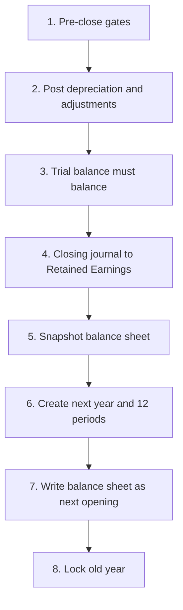
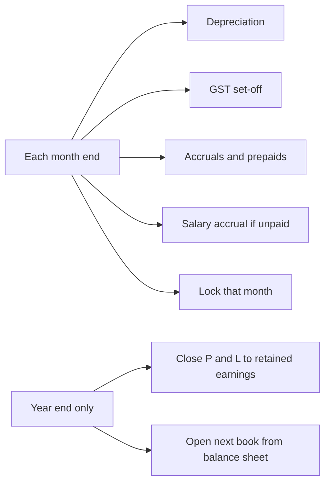

# Proper Books — Accountant Research (what is missing, and how to build it)

This note is written as a **company accountant / CA**, not as a feature list. It is the research for implementing **proper books** in Seravion Connect: depreciation, month-end adjustments, year-end close, and the **transfer into the next year’s opening book**.

It was checked against the live accounts docs in this folder, the backend (`YearEndCloseServiceImpl`, `FinanceBooksServiceImpl`, `FinancialReportsServiceImpl`, `FinancePostingHelper`, Indian GL seed `V160`), and the screens `/year-end-close`, `/financial-year`, `/books-setup`.

**Read this if you will build the close.** The existing [year-end screen](../../aurifex-connect-frontend-web/src/Pages/InternalAccounts/YearEndClose.jsx) looks finished. The books are not.

---

## 1. What “proper books” means in an office

A pest-control company keeps two kinds of accounts:

| Kind | Examples | At year end |
|------|----------|-------------|
| **Balance sheet** (what we still own or owe on 31 March) | Cash, bank, debtors, stock, vehicles, GST input, creditors, GST output, PF payable, owner capital, retained earnings | **Carry forward** as next year’s opening |
| **Profit and loss** (what we earned and spent this year only) | Service income, chemical purchase, salary, rent, depreciation | **Zero out** into retained earnings. Next year starts at zero |

The accounting equation that must still hold on the morning of 1 April:

```text
Assets = Liabilities + Capital
and
next year P&L opening = 0
```

**For the office user:** closing the year is not a lock icon. It is a set of journals that settle this year’s profit, then a new book that opens with yesterday’s balance sheet and a blank profit-and-loss.

---

## 2. Paper → system (how a CA actually closes)

| Today on paper (Tally / Excel) | Pain if skipped | In our system today | What proper books must do |
|--------------------------------|-----------------|---------------------|---------------------------|
| Asset register: vehicle, sprayer, furniture, cost, rate, method | Whole cost hits this year’s expense; profit is too low; no WDV for the auditor | No asset register. A furniture bill posts to **Purchase Expense** | Capitalise the asset. Charge depreciation every month |
| Month-end: depreciation, prepaid rent, accrued salary, GST set-off | P&L and GST payable are wrong in every month, not only in March | Manual journal only. Year-end checklist **ticks these as done** without checking | A close checklist that is computed, not decorative |
| 31 March: print trial balance, it must balance | Auditor rejects the file | Trial balance **adds opening twice** when openings were also posted as entries (see §6) | One source of opening. Trial balance Dr = Cr before close is allowed |
| Closing journal: income and expense → Retained Earnings | Profit stays inside P&L and is added again next year | **Partly built.** `YearEndCloseServiceImpl` posts this journal and marks the year `CLOSED` | Keep this journal. Fix the cases it skips |
| New company / new year in Tally: balance sheet becomes opening; P&L is blank | April books still show last year’s sales | **Not built.** No next financial year is created. Balance-sheet balances are not written as next year’s opening | This is the missing flow the office asked for |
| Period lock: nobody posts a March invoice in April without a reopen | Backdated entries rewrite a closed year | Periods are stamped `LOCKED`. Posting **does not read that stamp** | Reject any voucher dated in a locked period |
| Annual contract collected in April for 12 visits | Whole fee is “income” in April; the other 11 months look loss-making | Invoice approve credits **Sales Income** immediately | Deferred income, released each month |

---

## 3. What already works (do not rebuild)

These flows post balanced lines and should stay:

| Flow | Typical journal |
|------|-----------------|
| Sales invoice approve | Dr Customer · Cr Sales · Cr GST output |
| Receipt | Dr Bank · Cr Customer (and TDS receivable / advance where used) |
| Purchase bill confirm | Dr Purchase expense · Dr GST input · Cr Vendor |
| Vendor payment | Dr Vendor · Cr Bank |
| Credit note / debit note | Adjustment ledgers |
| Contra | Cash ↔ bank, bank ↔ bank |
| Manual journal | User lines, must balance |
| Salary / F&F / petty / statutory challan | Seeded internal ledgers in `V160` |
| First-day opening trial balance | Must balance before go-live (`FinanceBooksServiceImpl.postOpenings`) |
| Retained earnings ledger | Seeded `RETAINED_EARNINGS` under capital head `3000-RETAINED` |

The year-end button does **only** this:

1. Read profit for `finance_years.start_date` → `end_date`.
2. Debit each income ledger whose P&L amount is **greater than zero**.
3. Credit each expense ledger whose P&L amount is **greater than zero**.
4. Put the net profit (credit) or net loss (debit) on Retained Earnings.
5. Set the year `CLOSED` and every period of that year `LOCKED`.

It does **not** open the next book.

---

## 4. The missing flow: close, then open the new book

### 4.1 What the screen promises vs what the code does

The wizard text says the net surplus is transferred and periods are locked. The user guide also says “Balance Sheet balances transfer to next FY opening.”

`YearEndCloseServiceImpl` stops after the retained-earnings journal. `FinanceBooksServiceImpl.ensureYearAndPeriods` creates a year only while books are **not** live, and only if an **OPEN** year is missing or the dates changed. After go-live, draft save is rejected. After close, the only year is `CLOSED`. **Nothing creates FY n+1.**

`/financial-year` is a read-only calendar. Its own subtitle says period lock is not in this wave. There is no Lock, Reopen, or “Open next year” button.

### 4.2 The close the accountant will sign

Do these steps **in this order**. Stop on the first failure. Do not mark the year closed if a later step fails.



**For the office user:**

1. The system refuses to close if bank is not reconciled, a depreciation run is missing, or the trial balance does not balance.
2. It moves this year’s profit into Retained Earnings.
3. It opens 1 April (or 1 January) with cash, debtors, creditors, assets, and capital still there, and with sales and expenses at zero.
4. March can no longer be edited unless a director reopens it with a reason.

### 4.3 Journals

**A. Close profit and loss (last day of the year)** — already sketched in code; must cover **net** balances, including credit-note heavy income (net debit) and expense reversals (net credit). Today any line whose amount is not `> 0` is skipped, so those ledgers never reach zero.

```text
Dr  each Income ledger          (credit balance)
    Cr  each Expense ledger     (debit balance)
    Cr  Retained Earnings       (if profit)
    Dr  Retained Earnings       (if loss)
```

Voucher number stays unique per year (`YEC-{yearId}`). Running close twice must be rejected (already rejected when status is `CLOSED`). A failed mid-post must roll back the year status. That part is transactional today; keep it.

**B. Do not “transfer” balance-sheet accounts with a second journal inside the old year.** Cash does not leave the company on 31 March. The transfer is a **new opening voucher on the first day of the new year**, copied from the old year’s **closing** balance sheet.

```text
Date: first day of new year
Ref:  OPENING  (new ref, not the original OPEN-1)

Dr  Asset ledgers          closing debit balances
    Cr  Liability ledgers  closing credit balances
    Cr  Capital ledgers    closing credit balances
        (Retained Earnings already includes this year’s profit)
```

Profit-and-loss ledgers are **omitted**. Their opening in the new year is zero.

**C. Opening must be stored once.** Pick one home for the figure:

| Store | Use |
|-------|-----|
| `ledgers.opening_balance` + `opening_balance_type` | The number the new year **starts** with. Replace it at each year open. Keep the previous year in a history table, not by adding another entry on top |
| One `OPENING` voucher dated the new year’s first day | The audit line the statement shows |

The trial balance must use **either** the master opening **or** the opening voucher inside the period sum, never both. Today it uses both (see §6.1).

### 4.4 Rules for the new book

| Rule | Why |
|------|-----|
| New year dates follow the same type: India 1 Apr–31 Mar, or calendar 1 Jan–31 Dec | Tax year and books year stay the year the company chose at go-live |
| Old year status `CLOSED`. New year status `OPEN` | Reports and the year-end screen must show the open year, not `years[0]` if that row is the closed one |
| P&L for the new year ignores last year’s dates | Already true **if** the report is filtered by the financial year. The balance sheet currently adds profit from **1 January**, not from 1 April (§6.2) |
| Customer and vendor pending invoices stay open | Closing books does not mark invoices paid. Sub-ledgers carry because the party ledger balance carries |
| Go-live opening (`OPEN-1`) is never deleted by year open | Year 2 uses a new ref such as `OPEN-FY2027` |
| Reopen of a closed year | CEO + reason. Reverse the closing journal, delete the next year’s opening voucher **only if no voucher exists in the new year**, set the old year back to `OPEN` |

### 4.5 Worked example (India FY)

Company year: 1 Apr 2025 – 31 Mar 2026.

| Ledger | 31 Mar closing | Where it goes on 1 Apr 2026 |
|--------|----------------|-----------------------------|
| Bank | Dr 8,00,000 | Opening Dr 8,00,000 |
| Debtors | Dr 2,50,000 | Opening Dr 2,50,000 |
| Vehicle (cost) | Dr 6,00,000 | Opening Dr 6,00,000 |
| Accumulated depreciation | Cr 1,20,000 | Opening Cr 1,20,000 |
| Creditors | Cr 90,000 | Opening Cr 90,000 |
| GST output | Cr 40,000 | Opening Cr 40,000 |
| Capital | Cr 10,00,000 | Opening Cr 10,00,000 |
| Retained earnings | Cr 4,00,000 after close | Opening Cr 4,00,000 |
| Sales income | 0 after close | Opening 0. Do not copy the year’s sales |
| Depreciation expense | 0 after close | Opening 0 |

Check: assets 8,00,000 + 2,50,000 + 6,00,000 − 1,20,000 = 15,30,000.  
Claims 90,000 + 40,000 + 10,00,000 + 4,00,000 = 15,30,000.

---

## 5. Depreciation of assets (the other missing critical flow)

### 5.1 What goes wrong today

There is **no asset table, no schedule, and no month-end job** in the backend. Depreciation heads exist only in demo SQL and in the user guide, not in the tenant seed `V160`.

A real purchase is posted like this (`BillsServiceImpl` always resolves `BILL_CONFIRM_EXPENSE`):

```text
Dr  Purchase Expense     cost
Dr  GST Input            tax
    Cr  Vendor                 total
```

A ₹6,00,000 fogging vehicle is then **this year’s expense**. Profit collapses in the purchase month. Next year there is no asset and nothing to depreciate. The year-end screen still shows a green tick: “Depreciation schedules, provisions, and month-end journal vouchers are posted.” Nothing verified that sentence.

Petty cash category `ASSET_PURCHASE` has the same hole: it debits petty expense, not an asset.

**For the office user:** a vehicle, fogger, or furniture set that will be used for more than a year is not “purchase.” It is something the company still owns. Only a slice of its cost belongs to this month.

### 5.2 Heads to seed (company-wide)

| Code idea | Name | Group | Nature | Report |
|-----------|------|-------|--------|--------|
| `1600-FA` | Fixed Assets (group, not postable) | Asset | DR | Balance sheet |
| `1610-FA-VEHICLE` | Vehicles | Asset | DR | Balance sheet |
| `1620-FA-PLANT` | Plant and equipment (sprayers, foggers) | Asset | DR | Balance sheet |
| `1630-FA-FURN` | Furniture and fixtures | Asset | DR | Balance sheet |
| `1640-CWIP` | Capital work in progress | Asset | DR | Balance sheet |
| `1690-ACCUM-DEP` | Accumulated depreciation | Asset | **CR** | Contra asset. Subtract from cost. Do not park this under Liabilities |
| `5280-DEP` | Depreciation expense | Expense | DR | P&L, **not** gross profit |
| `5290-LOSS-ASSET` | Loss on sale of asset | Expense | DR | P&L |

Accumulated depreciation is a **credit-nature asset** (a minus on the asset side). If it is created as a liability, the balance sheet overstates both assets and liabilities.

### 5.3 Asset register (one row per asset)

| Field | Meaning |
|-------|---------|
| Asset code, name, branch | Which vehicle or machine |
| Category | Vehicle / plant / furniture — picks the cost ledger and the default rate |
| Cost ledger, accum-dep ledger | Where the GL lives. Many assets may share one ledger; the register holds the asset-wise WDV |
| Cost, accum dep, WDV | WDV = cost − accum dep. WDV never goes below residual / salvage |
| Method | **SLM** (straight line) or **WDV** (written down value). Companies Act books are often SLM; Income-tax block is separate and out of scope here |
| Rate % or useful life (months) | Example: vehicle 15% WDV, or furniture 10 years SLM |
| Put-to-use date | Depreciation starts that month, not the purchase-order date |
| Residual value | SLM stops at this amount |
| Bill id / vendor | Link to the purchase bill that capitalised it |
| Status | Draft, In use, Fully depreciated, Sold, Scrapped |

### 5.4 Journals the register must post

**Buy and capitalise** (bill confirm when the line is an asset, not a chemical):

```text
Dr  Vehicles                    6,00,000
Dr  GST input                     1,08,000
    Cr  Vendor                              7,08,000
```

GST on a business vehicle/equipment is input credit when the vendor is registered. The asset cost in the register is the amount **excluding** GST that was claimed. If GST is not claimable, cost includes that tax. Do not also debit Purchase Expense.

**Every month, for each asset in use** (job on the last day of an open period):

SLM per month = (cost − residual) / useful life in months.  
WDV per month = opening WDV × annual rate / 12.  
Skip if WDV is already at residual. Skip if the period is locked. One voucher per month (`DEP-YYYY-MM`), idempotent.

```text
Dr  Depreciation expense         7,500
    Cr  Accumulated depreciation         7,500
```

**Sell or scrap:**

```text
Dr  Bank                         sale proceeds
Dr  Accumulated depreciation     dep to date
Dr  Loss on sale                 if proceeds < WDV
    Cr  Vehicle cost                       original cost
    Cr  Profit on sale                     if proceeds > WDV
```

Remove the asset from “in use.” Do not leave cost sitting on the balance sheet.

### 5.5 What depreciation is not

- It is not a petty-cash category.
- It is not a manual journal the checklist pretends was posted.
- It is not Income-tax “block of assets” or deferred tax. Those can wait.
- A chemical consumed on a job is **not** a fixed asset. That stays purchase / stock.

---

## 6. Loopholes that make a close unsafe even after the new flow

These are in the current code. Closing on top of them will copy a wrong balance sheet into next year.

### 6.1 Opening is counted twice on the trial balance

Go-live writes `ledgers.opening_balance` **and** posts an `OPENING` ledger entry (`FinanceBooksServiceImpl.postOpenings`).

The trial balance (`FinancialReportsServiceImpl`) adds `opening_balance` **and** every posted entry up to the date, including that opening entry.

**Effect:** bank opening ₹5,00,000 can show as ₹10,00,000. A close that “snapshots the balance sheet” would carry the doubled figure. Fix the report before any year open.

### 6.2 Balance sheet profit uses 1 January, not the financial year

`getBalanceSheet` calls profit-and-loss from `asOfDate.withDayOfYear(1)`. For an April–March company, the 31 March balance sheet mixes January–March of the **new** tax year with the year that is being closed, and it **adds profit again** on top of capital.

After a real closing journal, retained earnings already holds the profit. Adding “current net profit” a second time makes Assets ≠ Liabilities + Capital.

**Rule:** current-year profit on the balance sheet is P&L from **the open financial year’s start** to the as-of date, and only for income/expense that has **not** yet been closed to retained earnings. On the day after close, that plug is zero because the journal already moved it.

### 6.3 Closing journal ignores the awkward side

Income is zeroed only when the P&L amount is `> 0` (net credit). A sales ledger that is net debit because of credit notes is left open. Expense that is net credit is left open. Retained earnings then does not equal the true net profit, and next year’s P&L still contains last year’s leftover.

Use the **signed net**. Debit a debit balance, credit a credit balance, until every income and expense ledger for that year is zero.

### 6.4 “Locked” does not lock

`YearEndCloseServiceImpl` sets `finance_periods.status = 'LOCKED'`. `FinancePostingHelper` only blocks dates **before books-from**. It never reads period status. An invoice dated 31 March can still be approved after the year is closed, which changes a year the close already settled.

**Rule:** if the entry date falls in a `LOCKED` period, reject the post. Reopen is a separate audited action.

### 6.5 The checklist is painted on

`YearEndClose.jsx` renders four green ticks (periods audited, bank matched, depreciation posted, statutory deposited). None of them are loaded from data. A user can close a year with no depreciation and an unbalanced trial balance. The third card always says “Balanced.”

Replace ticks with live checks: trial balance difference, count of in-use assets with no depreciation voucher this year, unreconciled bank lines, statutory ledgers with balances older than the due month.

### 6.6 Openings can be rewritten after the books are live

`updateOpenings` is allowed after go-live. It resets every ledger opening, deletes `OPEN-1`, and posts again. If April invoices already exist, the statement and the master opening no longer describe the same books.

**Rule:** opening edit is allowed only before the first non-opening voucher, or as a prior-period journal with its own voucher — never by deleting `OPEN-1`.

### 6.7 Capital vs expense is not a choice on the bill

Every confirmed bill debits the single purchase-expense binding. There is no “this line is an asset” flag. Until that exists, depreciation has nothing correct to depreciate.

### 6.8 Annual contracts are recognised too early

Pest-control AMCs are often invoiced once for a year. Approve credits Sales Income the same day. The books show a profit spike and eleven thin months. Auditors reclassify this as **deferred revenue** (liability) and release one-twelfth (or one visit) each period.

```text
On invoice:
  Dr  Customer
      Cr  Deferred revenue (liability)
      Cr  GST output          (GST is usually due on invoice; confirm with the CA — do not defer GST by default)

Each month of the contract:
  Dr  Deferred revenue
      Cr  Sales income
```

Without this, year-end profit is not the year’s work.

### 6.9 GST input and GST output never meet

Input sits as an asset. Output sits as a liability. The portal payment is the **net**. There is no month-end set-off journal and no “GST payable after set-off” line. The balance sheet overstates both sides by the same GST. It still balances, but the liability the company must pay is wrong.

```text
Dr  GST output
    Cr  GST input          (up to the lower of the two)
```

Pay the rest: Dr GST output · Cr Bank. This is a month-end journal, not a year-end-only journal.

### 6.10 Other gaps that block a signed balance sheet

| Gap | Office effect | Minimum proper treatment |
|-----|----------------|--------------------------|
| No bank reconciliation | Cheque issued in March, cleared in April, still looks like March cash | Mark cleared date. Balance sheet uses books date. A BRS report explains the bank statement |
| No bad-debt provision | Debtors include amounts nobody will pay | Dr Bad-debt expense · Cr Provision for doubtful debts (contra asset or liability, used the same way every year) |
| No prepaid / accrual | Annual insurance dumped into one month; March salary paid in April missing from March | Dr Prepaid · Cr Expense, then reverse monthly. Salary accrual Dr Salary · Cr Salary payable (salary payable ledger already exists) |
| Rent deposit expensed or mixed with rent | Balance sheet misses a refundable deposit | Dr Security deposit (asset) · Cr Bank. It is not rent |
| Single TDS payable | 194C and 194J cannot be filed from the ledger | Section-wise liability ledgers, already noted in the older gap note |
| Partnership / LLP | All profit sits in one retained earnings ledger | Optional split journal to partner capital after close. Not required for a private limited company |
| Cash flow and Schedule III layout | Auditor asks for them | After the close math is right. Do not block depreciation and year open on pretty groupings |
| Maker-checker on journals | One person can move bank to expense | Approve before a manual journal posts. System journals (depreciation, close, opening) are posted by the job and audited by voucher number |
| Stock vs expense | Chemicals bought are an expense on the bill even if still in the godown | A later phase: Dr Inventory on GRN, Dr Consumption on job issue. Do not pretend purchase expense is stock |

---

## 7. Month-end vs year-end (do not mix them)



**For the office user:** depreciation is every month. Moving profit to retained earnings is once a year. If depreciation is only typed in March, eleven monthly P&Ls are wrong even if the year total is right.

Suggested order inside March:

1. Finish invoices, bills, receipts, payments, salary, statutory challans.
2. Run depreciation for March.
3. GST set-off and accruals.
4. Bank reconciliation for all bank ledgers.
5. Trial balance balances.
6. Close year.
7. System opens the next year. Accountant does not retype the balance sheet.

---

## 8. Build checklist (what a developer implements)

| # | Build | Done when |
|---|--------|-----------|
| 1 | Trial balance uses one opening figure | A ₹5,00,000 bank opening prints as ₹5,00,000, not ₹10,00,000 |
| 2 | Balance sheet P&L uses the financial year, and does not add profit already inside retained earnings | 31 March sheet balances after close |
| 3 | Period lock enforced inside `FinancePostingHelper` | A March invoice after close is rejected |
| 4 | Asset heads + register + bill line “Capitalise” | Vehicle bill debits Vehicles, not Purchase Expense |
| 5 | Monthly depreciation voucher, idempotent | Re-running March does not double the charge |
| 6 | Sale / scrap journal | WDV leaves the balance sheet |
| 7 | Closing journal uses signed nets | Credit-note-only income ledger ends at zero |
| 8 | Next year + 12 open periods + opening voucher from balance sheet only | 1 April sales ledger is zero; bank equals 31 March bank |
| 9 | Year-end screen shows real gates, not painted ticks | Close button stays disabled while the trial balance difference ≠ 0 |
| 10 | Opening rewrite locked after the first real voucher | `OPEN-1` cannot be deleted in December |
| 11 | Deferred revenue for annual contracts | A 12-month AMC does not all land in April income |
| 12 | GST set-off journal | Net GST payable matches what will be paid on the challan |

Screens to add or replace:

| Screen | Route idea | Who |
|--------|------------|-----|
| Asset register | `/fixed-assets` | Accountant |
| Run depreciation | action on that screen and on month-end | Accountant |
| Financial year | `/financial-year` | Lock / reopen a month; see closed vs open year |
| Year-end close | `/year-end-close` | Gates, preview of the closing journal, then “Open next year” |
| Bank reconciliation | `/bank-reconciliation` | Accountant, before close |

Permissions: CEO and a finance role with a dedicated **Close year** action. Depreciation run can sit on Journal / Internal Accounts edit. Reopen closed year is CEO only, with a stored reason.

---

## 9. Acceptance the accountant will test

**Given** a company whose books start 1 Apr 2025, with a vehicle bought for ₹6,00,000 on 1 Apr 2025, 15% WDV, and no other assets.  
**When** March 2026 depreciation has been run for 12 months and the year is closed.  
**Then** depreciation expense for the year equals the sum of the twelve charges, accumulated depreciation equals that sum, the vehicle cost is still ₹6,00,000, and retained earnings includes that expense.  
**And** on 1 Apr 2026 the vehicle, bank, debtors, and creditors match 31 Mar 2026, sales and depreciation expense open at zero, and a voucher dated 31 Mar 2026 is rejected.

**Given** opening bank Dr ₹5,00,000 posted at go-live.  
**When** the trial balance is printed the same day.  
**Then** bank closing debit is ₹5,00,000 and total debits equal total credits.

**Given** an annual service invoice of ₹1,20,000 plus GST on 1 April.  
**When** April is closed.  
**Then** sales income for April is ₹10,000 (one month) and deferred revenue is ₹1,10,000. GST output is the full tax if the firm’s policy is “GST on invoice.”

---

## 10. Assumptions

| ID | Assumption |
|----|------------|
| A1 | Default year remains India April–March. Calendar year is the same close mechanic with different dates |
| A2 | Books depreciation is SLM or WDV per asset. Income-tax block depreciation and deferred tax are out of this build |
| A3 | GST on a capital bill is input credit when the vendor is registered. Asset register cost excludes that GST |
| A4 | One retained earnings ledger is enough for a company. Partner-wise profit split is a follow-up journal, not the close itself |
| A5 | Customer invoices and vendor bills stay the sub-ledger. Year open copies **GL** balances; it does not clone invoice rows |
| A6 | Stock-to-COGS (chemical still in the godown) is a later inventory phase. This note does not re-post historical purchase bills |

---

## 11. Out of scope for this build

- Full Ind-AS 16 component accounting, impairment, and revaluation
- Consolidated group accounts and inter-company elimination
- Income-tax computation, MAT, and deferred tax
- Tally XML export (useful later; it does not fix the close)
- Automatic bad-debt percentages (the provision journal is enough; the percent is a policy the CA sets)
- Rewriting invoice, receipt, and vendor-payment math that already balances

---

## 12. Where this sits next to the other accounts docs

| Doc | Relationship |
|-----|----------------|
| [chart-of-accounts.md](./chart-of-accounts.md) | Five groups stay. Add the fixed-asset and contra-depreciation heads under Asset |
| [ledger-management.md](./ledger-management.md) | Opening balance rules in §6.1 and §6.6 override the “edit opening any time” habit |
| [bill-management.md](./bill-management.md) | Bill confirm must branch: expense line vs asset line |
| [invoicing.md](./invoicing.md) | Annual contracts need deferred revenue before they are “just sales” |
| [payments.md](./payments.md) | Manual journal remains the escape hatch. It is not the depreciation engine |
| [internal-accounts.md](./internal-accounts.md) | Salary accrual and statutory ledgers are reused. Close does not repost salary |
| [implementation_analysis.md](./implementation_analysis.md) | Furniture-as-expense is the loophole §5 closes |
| [docs/prd/indian-books-master-plan.md](../prd/indian-books-master-plan.md) | Phase H (assets) and Phase G (close **plus** next-year opening) are still open. This note is the accountant spec for those two phases |
